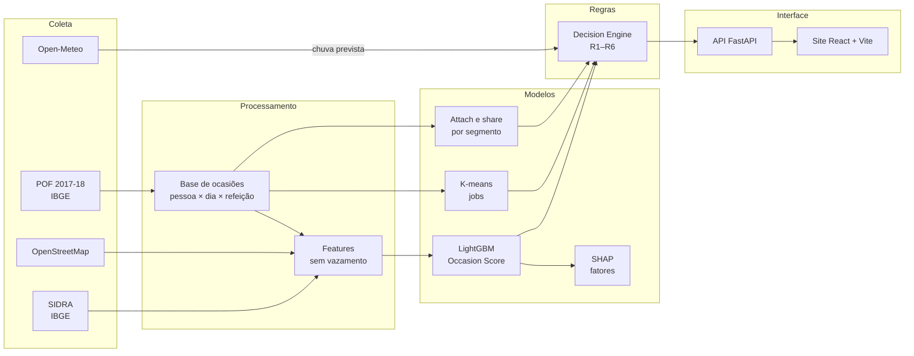

# Occasion Intelligence · Pizza + Guaraná

> **Onde a pizza reúne, Guaraná faz parte.** Um sistema de dados que estima **onde e quando** a ocasião de pizza é mais provável, mede **quanto o Guaraná já está nela** e recomenda **que tipo de ativação** faz sentido em cada contexto.

Case individual · Inteli Academy × Ambev · Raphaela Rodrigues Luvizotto

### ▶ [Vídeo de apresentação (até 5 min)](https://youtu.be/r-D8Go8H9U0)
Arquitetura, dados, métricas e validação, a API rodando e o site completo: da entrada ao Occasion Score e à recomendação.

---

## Sumário
1. [O problema e a ideia](#1-o-problema-e-a-ideia)
2. [Arquitetura](#2-arquitetura)
3. [Dados](#3-dados)
4. [Metodologia](#4-metodologia)
5. [Resultados](#5-resultados)
6. [Aplicação: API e site](#6-aplicação-api-e-site)
7. [Limitações](#7-limitações)
8. [Como executar](#8-como-executar)
9. [Estrutura do repositório](#9-estrutura-do-repositório)
10. [Próximos passos](#10-próximos-passos)

---

## 1. O problema e a ideia

O desafio é fortalecer a associação **Pizza + Guaraná**. Não existe base pública que registre essa ocasião, então ela foi construída a partir do consumo alimentar declarado na POF (IBGE).

O sistema responde três perguntas, cada uma com uma peça própria:

| Pergunta | Peça | Saída |
|---|---|---|
| **Onde e quando** a pizza acontece? | Modelo de previsão (LightGBM) | Occasion Score + fatores (SHAP) |
| **Que tipo** de ocasião é? | Agrupamento (K-means) | Job to be done |
| **Quanto o Guaraná** já está nela? | Métricas de marca por segmento | Attach de refrigerante e share de guaraná |
| **O que fazer?** | Decision Engine (regras R1–R6) | Categoria de ativação + justificativa + plano |

O modelo **prioriza contextos**: ele não promete vendas. Medir o efeito de uma ativação exige um experimento, cujo protocolo está em [docs/protocolo_experimento.md](docs/protocolo_experimento.md).

---

## 2. Arquitetura



**Camadas separadas**, cada uma num lugar do código:

| Camada | O que faz | Onde |
|---|---|---|
| Coleta | Lê os microdados da POF e busca as fontes externas | `src/pof.py`, `src/coleta_externa.py`, `src/coleta_clima.py` |
| Processamento | Monta a base de ocasiões e define as features (uma única definição para treino e API) | `notebooks/01`, `notebooks/02`, `src/features.py` |
| Modelo | Treino, validação, explicação e agrupamento | `notebooks/03`, `notebooks/04`, `src/explicar.py`, `models/` |
| Regras | Transforma score + contexto + fatores em uma categoria de ativação | `src/decision_engine.py`, `src/briefing.py` |
| Interface | Serviço de inferência, API e site | `src/servico.py`, `api/main.py`, `web/` |

---

## 3. Dados

### Unidade de análise e target
| | Definição |
|---|---|
| **Unidade de análise** | **Ocasião de consumo**: uma pessoa, num dia de registro, numa refeição (café, almoço, lanche, jantar, ceia, outra) |
| **Base** | 363.412 ocasiões de cerca de 46 mil pessoas; **347.985** com refeição declarada são usadas na modelagem |
| **Target** | `y_pizza`: a ocasião teve pelo menos um item de pizza (consumo declarado, ground truth) |
| **Taxa** | ~0,5% (1.711 ocasiões com pizza): classe rara |
| **Instante de previsão** | Antes da refeição: só quem é a pessoa, onde mora, dia, horário, refeição e local |

**Por que o target não é "pizza + guaraná":** só existem **184** ocasiões com os dois, pouco para treinar e avaliar com estabilidade. O Guaraná entra como **métrica de marca por segmento**:
- **attach de refrigerante** = % das pizzas que vêm com refrigerante;
- **share de guaraná** = % desses refrigerantes que são guaraná.

### Fontes
| Fonte | Papel |
|---|---|
| **POF 2017-18, IBGE** (Consumo Alimentar + Morador) | Target, contexto da ocasião, pessoa e família |
| **SIDRA, IBGE** (tabelas 6579 e 7531) | População e renda média por UF |
| **OpenStreetMap** (Overpass, `cuisine=pizza`) | Oferta: pizzarias por 100 mil habitantes, por UF |
| **Open-Meteo** (previsão) | Chuva prevista no dia escolhido, consultada em tempo real pela API |
| **Delivery Center (Kaggle) + Open-Meteo histórico + BrasilAPI** | Estudo à parte do efeito da chuva no delivery (notebook 05). **Não** entra no modelo nem é juntado à POF |

**Integração:** a POF é juntada às fontes externas **só por UF**. Fontes avaliadas e descartadas (Google Trends, Vigitel, iFood, Pizza Sales) e o motivo de cada uma estão no Data Card.

### Anti-vazamento
- Excluídas todas as informações do que foi consumido na ocasião (`tem_refri`, `tem_guarana`, número de itens) e o `DIA_ATIPICO`, que é respondido depois.
- Imputação e codificação são ajustadas **só no treino**, dentro de um `sklearn.Pipeline`.
- Um teste automatizado garante que nenhuma feature proibida entra no modelo.

---

## 4. Metodologia

### 4.1 Análise exploratória (notebook 02)
- Todas as taxas usam o **peso amostral** da POF (estimativas da população, nunca contagens brutas).
- Padrões por dia × período, região, renda, local e composição familiar.
- Interações exploradas: dia × período virou a feature `dia_periodo`.
- Features territoriais por UF: pizzarias por 100 mil habitantes, renda média e população.

### 4.2 Features
| Família | Variáveis |
|---|---|
| Contexto (calendário e canal) | dia da semana, fim de semana, horário, período do dia, dia × período, refeição, local, em casa |
| Pessoa e família | idade, sexo, escolaridade, renda per capita (log), moradores, crianças (0–11), adolescentes (12–17) |
| Território e oferta | região, área urbana, pizzarias por 100 mil hab., renda média da UF, população da UF (log) |

A definição fica num único arquivo, [`src/features.py`](src/features.py), usado tanto no treino quanto na API.

### 4.3 Modelos (notebook 03)
1. **Baselines sem machine learning:** a regra fixa "sexta a domingo à noite" e a frequência histórica de pizza por dia × período.
2. **Modelos candidatos:** Regressão Logística, Random Forest e **LightGBM** (árvores de decisão em sequência, cada uma corrigindo os erros da anterior), todos no mesmo `Pipeline`.
3. **Escolha pela validação cruzada.** O conjunto de teste foi aberto **uma única vez**, no final.

### 4.4 Validação
A POF não traz a data da entrevista, só o dia da semana, então **não há como fazer validação temporal**. Ela foi substituída por dois cortes que medem generalização:
- **Por domicílio:** 5 dobras agrupadas por domicílio, mais um teste com 20% dos domicílios. A mesma família nunca aparece em treino e teste.
- **Por região:** treina em 4 regiões e testa na 5ª, que o modelo nunca viu.

### 4.5 Métrica principal
Com 0,5% de positivos, a acurácia engana: um modelo que sempre diz "não" acerta 99,5%. A métrica principal é a **PR-AUC**, que mede se o modelo encontra as pizzas sem encher a lista de alarmes falsos. Complementam o **lift** e o **recall nos 10% de maior score**, que respondem à pergunta de negócio: "se eu ativar só nos 10% melhores contextos, quantas ocasiões alcanço?".

Custo dos erros: deixar passar uma ocasião relevante custa mais do que uma ativação num contexto pouco provável (por exemplo, um push). Por isso o corte "alta" é generoso.

### 4.6 Occasion Score (definido antes da avaliação)
- **`occasion_score`** = P(pizza | contexto): a probabilidade de uma ocasião com aquele contexto ter pizza. É **calibrada**: entre contextos com score de 2%, cerca de 2% têm pizza.
- **`lift`** = score ÷ média Brasil.
- **`classification`**: **alta** (top 10% dos contextos na validação), **média** (acima da média Brasil) e **baixa** (abaixo dela).

### 4.7 Explicação, jobs e métricas de marca (notebook 04)
- **SHAP** global e por previsão: mostra quanto cada informação empurrou o score para cima ou para baixo.
- **K-means** sobre as ocasiões de pizza (escolha do número de grupos por cotovelo e silhueta), resultando em 6 **jobs to be done**.
- **Attach e share** por segmento (região × faixa de renda) e por job, **suavizados** em direção à média Brasil para não exagerar segmentos pequenos.
- **Mapa de oportunidade por UF**: cruza a propensão à pizza com o espaço que falta ao Guaraná.

### 4.8 Decision Engine
Regras explícitas, documentadas e **testadas**. Não é um segundo modelo, porque não existe histórico de campanhas para aprender "a melhor ação". A primeira regra que casar define a recomendação; as outras que também casarem viram ações complementares.

| Regra | Condição | Recomendação |
|---|---|---|
| R1 | Score baixo | Não priorizar |
| R2 | Score alto ou médio + consumo fora de casa | Ativação no ponto de consumo |
| R3 | Score alto + em casa + (fim de semana **ou** chuva prevista) | Ativação via delivery |
| R4 | Attach de refrigerante do segmento abaixo do Brasil | Combo / promoção para casa |
| R5 | Share de guaraná do segmento abaixo do Brasil | Awareness e associação |
| R6 | Demais casos | Manutenção de marca |

Toda recomendação traz uma **justificativa** em texto e um **plano de campanha** (canal, momento, público, mensagem, formato e como medir), sempre apresentado como **hipótese a testar**. Detalhes em [docs/decision_engine.md](docs/decision_engine.md).

### 4.9 Clima (notebook 05)
A POF não tem data, então o clima não pode ser aprendido pelo modelo. Ele entra como **gatilho de regra** (R3), sustentado por um estudo à parte com pedidos reais de delivery de 2021: regressão com efeitos fixos (cidade × dia da semana, cidade × semana) e intervalo de confiança por bootstrap.

---

## 5. Resultados

### Occasion Prediction: teste final (20% dos domicílios, aberto uma vez)
| Modelo | PR-AUC | ROC-AUC | Lift top 10% | Recall top 10% |
|---|---|---|---|---|
| *Chute (média)* | *0,005* | *0,500* | *1,0×* | *10%* |
| Baseline dia × período | 0,019 | 0,806 | 4,0× | 40% |
| Regressão Logística | 0,074 | 0,874 | 6,7× | 67% |
| Random Forest | 0,086 | 0,877 | 6,8× | 68% |
| **LightGBM (escolhido)** | **0,084** | **0,886** | **6,8×** | **68%** |

- **4,4× a PR-AUC do baseline.** Ativando só nos 10% de contextos com maior score, o modelo alcança **68% das ocasiões de pizza**, contra 40% do baseline com o mesmo esforço.
- O LightGBM foi escolhido pela **validação cruzada** (PR-AUC 0,080, contra 0,076 do Random Forest e 0,073 da Logística). No teste, os três ficam próximos, e a diferença para o Random Forest é ruído.
- **Generaliza:** validação cruzada (0,080) ≈ teste (0,084). A curva de calibração fica próxima da diagonal.
- **Matriz de confusão no teste** (corte "alta"): 252 pizzas encontradas, 119 perdidas e 6.720 ativações sem pizza, entre cerca de 70 mil ocasiões.

### O que traz o ganho: ablação (validação cruzada, PR-AUC do LightGBM)
| Features | PR-AUC |
|---|---|
| Baseline dia × período | 0,018 |
| Contexto (dia, horário, refeição, local) | 0,072 |
| + Pessoa (idade, renda, família) | 0,081 |
| + Território (região, pizzarias, renda e população da UF) | 0,080 |

**Regiões nunca vistas** (treina em 4, testa na 5ª): o LightGBM vai de 0,088 sem território para **0,093 com território**, melhor em 4 de 5 regiões (baseline: 0,019). O território não ajuda a decorar, ajuda a **generalizar**.

### Explicação, segmentos e erros
- **SHAP:** local da refeição, horário, tipo de refeição e renda são os fatores que mais movem o score, coerentes com o negócio e sem sinal de vazamento.
- **Segmentos:** o LightGBM supera o baseline em todos. À noite, vai de 0,021 para 0,095. **Em casa** é o segmento mais difícil (0,044, contra 0,166 fora de casa), mas ainda 3× o baseline.
- **Análise de erros:** as pizzas perdidas são as **"fora de hora"** (almoço, café, tarde), em dias úteis e em casa, raras e pouco antecipáveis. Os falsos positivos são **jantares em casa** com cara de pizza: um erro barato para uma ativação.

### Guaraná na ocasião (POF, ponderada)
- **37%** das pizzas vêm com refrigerante, e o **guaraná é 29%** desses refrigerantes.
- **Famílias com criança:** share de guaraná cerca de 2× maior (41% contra 19%).
- **Jobs:** "Jantar em família com crianças" tem o maior share (38%). "Pizza fora de casa (social)" (19%) e "Pizza em casa no meio da semana (adultos)" (20%) são onde o Guaraná tem **mais espaço**.
- **Faixa de renda mais alta** (quintil A de renda per capita): maior taxa de pizza e **menor share de guaraná** (~17%).
- **Mapa de oportunidade (top 5 UFs):** RS, DF, SC, PR e RR.

### Clima
- A comparação ingênua sugeria **queda** de pedidos com chuva. Era efeito do crescimento da empresa ao longo dos meses (confundidor).
- Controlando cidade, dia da semana e semana, **dias chuvosos têm +5,7% de pedidos de comida à noite** (IC 95%: +1,1% a +10,7%). A chuva na hora exata não tem efeito detectável.

---

## 6. Aplicação: API e site

### API (FastAPI)
| Endpoint | O que faz |
|---|---|
| `POST /predict` | Recebe o contexto e devolve score, fatores, job, recomendação e plano |
| `GET /clima/{uf}` | Previsão de chuva para o próximo dia da semana escolhido (Open-Meteo) |
| `GET /oportunidades` | Métricas de marca por segmento, por job e por UF (alimenta o mapa e os jobs) |
| `GET /opcoes`, `GET /health` | Valores aceitos e estado do serviço |

**Exemplo real.** Entrada: quarta, 17h, jantar em casa, SP, família de 4 com uma criança, chuva prevista.

```json
POST /predict
{ "dia_semana": "Quarta-Feira", "hora": 17, "refeicao": "jantar", "local": "casa",
  "uf": "SP", "idade": 32, "sexo": "F", "renda_pc": 1500,
  "n_moradores": 4, "n_criancas": 1, "n_adolescentes": 0, "chuva_prevista": true }
```

Saída (resumida), com os **seis campos do contrato**:

```json
{
  "occasion_score": 0.0073,
  "classification": "media",
  "top_factors": [
    { "fator": "Refeição", "valor": "jantar", "direcao": "aumenta" },
    { "fator": "Renda média da UF", "valor": 1773, "direcao": "aumenta" },
    { "fator": "Horário", "valor": 17, "direcao": "aumenta" }
  ],
  "recommendation_category": "COMBO_CASA",
  "recommendation_reason": "No segmento, só 31% das pizzas vêm com refrigerante (Brasil: 37%): espaço para combo pizza + Guaraná. Principais fatores do score: Refeição (aumenta), Renda média da UF (aumenta), Horário (aumenta). Job provável: Jantar em família com crianças.",
  "model_metadata": { "modelo": "LightGBM (sklearn Pipeline)", "versao": "1.0.0", "versao_contrato": "1.0" }
}
```

A resposta completa também traz `lift`, `job`, `segmento`, `rule_fired`, `acoes_complementares` e `briefing` (plano de campanha). Valores fora do contrato são recusados com erro **422**, e uma versão de contrato não suportada também. A documentação interativa fica em `http://localhost:8000/docs`.

### Site (React + Vite)
Organizado em três atos, seguindo as perguntas do sistema:
1. **Onde:** mapa do Brasil com troca de métrica (potencial de ativação, ocasião de pizza, share de guaraná e pizzarias por 100 mil hab.) e o detalhe de cada estado.
2. **O que falta:** achados clicáveis e explorador dos jobs to be done, com o share de guaraná de cada um comparado à média Brasil.
3. **O que fazer:** simulador com cenários rápidos, previsão do tempo real, Occasion Score com termômetro, recomendação com o porquê, fixar para comparar cenários e plano de campanha.

Guia de pastas do front em [web/README.md](web/README.md).

---

## 7. Limitações
- **Marca:** a POF identifica a categoria "refrigerante de guaraná", não a marca Guaraná Antarctica.
- **Tempo:** dados de 2017-18, sem data (só dia da semana), por isso não há validação temporal e o clima entra como regra, não como feature aprendida.
- **Canal:** "em casa" mistura delivery, congelados e preparo próprio.
- **Autodeclaração:** pode haver sub-registro de alimentos considerados pouco saudáveis.
- **Oferta:** o OpenStreetMap tem cobertura desigual entre estados e é de 2026; serve como indicador relativo.
- **Erros do modelo:** as pizzas "fora de hora" (almoço, café, tarde) são as que ele mais perde.
- **Amostras pequenas:** as métricas de Guaraná por segmento são suavizadas em direção à média Brasil.
- **Clima:** o estudo usa comida em geral (não só pizza), em 2021 (pandemia), em 4 cidades; mostra associação, não causalidade.
- **Causalidade:** o sistema prioriza contextos, não garante vendas. O efeito de uma ativação só pode ser medido com um teste A/B ([protocolo](docs/protocolo_experimento.md)).

---

## 8. Como executar

Testado no Windows 11 com Python 3.14 e Node.js 24.

### 8.1 Ambiente
```bash
py -m venv .venv
.venv\Scripts\python -m pip install -r requirements.txt
```

### 8.2 Dados
1. **POF:** baixe `Dados_20230713.zip` e `Documentacao_20230713.zip` em
   `https://ftp.ibge.gov.br/Orcamentos_Familiares/Pesquisa_de_Orcamentos_Familiares_2017_2018/Microdados/`.
   Extraia `CONSUMO_ALIMENTAR.txt` e `MORADOR.txt` em `data/raw/pof/` e a documentação em `data/raw/pof/documentacao/`.
2. **Features territoriais** (SIDRA + OpenStreetMap; o OSM tem cache em `data/external/`):
   ```bash
   .venv\Scripts\python -m src.coleta_externa
   ```
3. **Só para o notebook 05:** baixe o dataset *Brazilian Delivery Center* no Kaggle (`nosbielcs/brazilian-delivery-center`), extraia os `.csv` em `data/raw/delivery_center/` e colete clima e feriados:
   ```bash
   .venv\Scripts\python -m src.coleta_clima
   ```

### 8.3 Pipeline completo
Executa os notebooks 01 a 05 em ordem e gera os artefatos em `models/`:
```bash
.venv\Scripts\python rodar_pipeline.py
```

### 8.4 Testes
Anti-vazamento, regras do Decision Engine, casos limite, plano de campanha e contrato da API:
```bash
.venv\Scripts\python -m pytest -q
```

### 8.5 Aplicação
API, na porta 8000:
```bash
.venv\Scripts\python -m uvicorn api.main:app --port 8000
```
Site, na porta 5173, num segundo terminal:
```bash
cd web
npm install
npm run dev
```
Abra `http://localhost:5173`. O site usa a API em `http://127.0.0.1:8000`; para outro endereço, defina `VITE_API_URL`.

---

## 9. Estrutura do repositório
```
caseAmbev/
├── notebooks/
│   ├── 01_construcao_base.ipynb        POF → base de ocasiões, target e features
│   ├── 02_eda_territorio.ipynb         EDA ponderada e features territoriais
│   ├── 03_modelos_validacao.ipynb      baselines, modelos, validação, calibração, segmentos e erros
│   ├── 04_explicabilidade_jobs.ipynb   SHAP, K-means (jobs), métricas de marca e mapa por UF
│   └── 05_eda_clima.ipynb              efeito da chuva no delivery (estudo à parte)
├── src/
│   ├── pof.py                          leitura dos microdados com o layout oficial do IBGE
│   ├── coleta_externa.py               SIDRA + OpenStreetMap
│   ├── coleta_clima.py                 Open-Meteo histórico + feriados
│   ├── features.py                     definição única das features (treino e API)
│   ├── explicar.py                     fatores SHAP legíveis por previsão
│   ├── decision_engine.py              regras R1–R6
│   ├── briefing.py                     plano de campanha por recomendação
│   └── servico.py                      serviço de inferência usado pela API
├── api/main.py                         API FastAPI
├── web/                                site React + Vite
├── models/                             modelo treinado, jobs, segmentos e metadados
├── data/external/                      snapshots datados das fontes externas
├── docs/
│   ├── data_card.md                    Data Card
│   ├── decision_engine.md              regras e ligação com Jobs to be Done
│   └── protocolo_experimento.md        protocolo de teste A/B
├── tests/test_pipeline.py              testes automatizados
├── rodar_pipeline.py                   roda os notebooks em ordem
└── requirements.txt                    versões fixadas
```
Os microdados brutos (`data/raw/`) e as bases processadas não são versionados; o passo 8.2 recria tudo.

---

## 10. Próximos passos
- **Dados de pedidos da Ambev ou de um parceiro**, com data, marca e canal: validação temporal e target "pizza + Guaraná Antarctica".
- **Teste A/B do combo pizza + Guaraná** com um parceiro de delivery, seguindo o [protocolo](docs/protocolo_experimento.md).
- **Entender as pizzas "fora de hora"** usando a variável `DIA_ATIPICO` da POF como diagnóstico.
